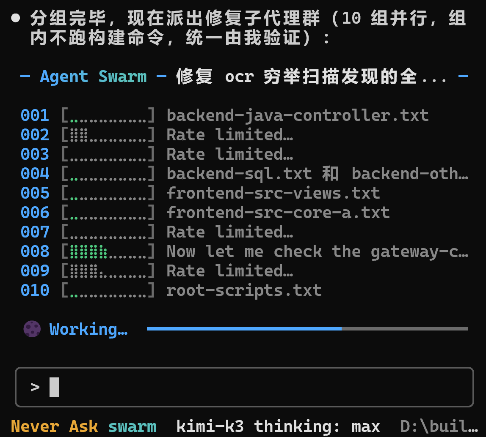

# open-tui-orchestrator

A local Node.js orchestrator for Agents (tools that receive tasks and act through a CLI, or command-line interface).

> Project docs / 项目规范： [Contributing](CONTRIBUTING.md) · [Security](SECURITY.md) · [Code of Conduct](CODE_OF_CONDUCT.md) · [Issue templates](.github/ISSUE_TEMPLATE) · [Pull request template](.github/pull_request_template.md)

**Windows-only today.** The launchers, the invisible ConPTY carrier and the machine-wide coordinator are Windows-specific; other platforms get a diagnostic instead of a half-working install. Before you run it, read [docs/trust-and-safety.md](docs/trust-and-safety.md) — it states plainly what this tool does on your machine (hidden agents running with your credentials, bypassed approvals for Codex-hosted runs, the exact files it writes). Security reports: [SECURITY.md](SECURITY.md). Contributing: [CONTRIBUTING.md](CONTRIBUTING.md).

## Overview

open-tui-orchestrator is designed for complex, long-running requests with several parts that can be advanced independently. It first creates a complete TODO LIST, an authoritative task ledger and a dependency graph. Semantic work stays with the planner: the model may classify ownership, resources and dependencies, while deterministic code validates task coverage, detects conflicts, groups work and schedules dependency waves.

When the plan contains genuinely parallel work, the orchestrator spawns one execution unit per block and runs those blocks at the same time. Units default to headless: the same launcher runs under a hidden carrier, so nothing pops up and focus is never stolen — pass `--mode window` when you want the visible TUI (terminal user interface) windows. Resource keys, dependency edges and capacity leases (shared records that limit the number of active units) coordinate the units. Task start, completion, result verification and unit closure all leave durable evidence, and a live run board (`[board]` stdout lines, run `events.jsonl`, read-only `--watch <runId>`) mirrors block and task state in real time; the run is complete only after every task is independently verified.

The orchestrator is for complex work, not for wrapping every small command in a window. A single task, a single-block plan or a plan whose dependencies force serial execution stays inline: the CLI returns the complete original task inventory and the reason, and the initiating Agent executes it in the current conversation. A visible run starts only when at least two blocks are ready in the same dependency wave, so skipping a window never means dropping a task.

Window capacity is computed from the memory that is actually available right now, using a per-host memory profile learned from real runs rather than a fixed formula.

```text
per-host unit estimate   = p90(observed unit peaks) × 1.3   (host-agnostic; falls back to a 640 MB default
                                                             until at least 3 samples exist)
admittable units         = floor((available memory MB − 1000) / unit estimate)
```

The 1000 MB term is a reserve floor: memory the run must leave free (`ORCH_MIN_FREE_MEM_MB`, default 1000). *Available* rather than total memory is used on purpose: memory other processes already hold is not capacity this run can hand out. Before a wave opens, the orchestrator checks that `available − estimated block cost ≥ reserve`; if it does not fit, blocks are merged into serial blocks until it does, and the merge decision is printed as one auditable `[mem-fit] units=… unitMb=… estMb=… freeMb=… floorMb=… fits=… merges=…` line. A cross-run, cross-workspace coordinator then confirms the number of active windows; both active windows and reservations that are still starting consume capacity. When there are more tasks than the capacity, extra tasks are merged into existing blocks and run serially inside those blocks. They are not moved to a later capacity batch and they are never removed from the original ledger.

For example, on a machine with 8000 MB free and a learned 640 MB unit estimate, 11 units are admittable; nine independent tasks become nine one-task blocks that all fit without merging. At most nine windows open at once, while all nine tasks remain in the ledger and must pass verification.

Units defend themselves: a unit that stays alive but stops producing evidence (no checkpoint movement, no result file, no launcher-log growth) is declared stalled after `ORCH_UNIT_STALL_MS` (default 600000 ms), then closed and retried inside the block's attempt budget instead of being waited on until the run deadline; `ORCH_UNIT_TIMEOUT_MS` (default 2700000 ms) caps one unit's lifetime. Windows left over from a killed unit are swept before the runner starts, so a power cut never leaves dead panes for a user to close by hand.

Windows Terminal is the default host. Windows inherit the initiating conversation's working directory, and in `--mode window` the fresh window is deliberately brought to the front (raised, then asked for the foreground) so the person who started the run can actually see it — set `ORCH_WINDOW_NOACTIVATE=1` to keep windows in the background instead. Launchers, results, locks, decomposition state and recovery ledgers live under `temp/orchestrator` in that workspace. The host Agent keeps its own configuration, sessions and credentials in its normal location. PowerShell is used only for Windows lifecycle, encoding and process-tree helpers; Agent adapters and visible hosting prefer Node.js and Windows Terminal.

Codex, pi, opencode, Kimi Code and Hermes Agent adapters (a translation layer for each host CLI's arguments, output and shutdown behavior) are connected. The host is selected with `--agent`/`ORCH_AGENT`, host environment markers, or auto-detection of the initiating agent from the Windows ancestor process chain — whichever agent starts a run drives its own CLI in the windows, and the windows inherit the initiating window's current model and thinking effort (explicit `ORCH_MODEL`/`ORCH_EFFORT` win; otherwise detected per host — Codex rollout, Kimi Code session wire log, pi settings, opencode settings, and for print-class profiled agents (Hermes Agent) the profile's `modelDetection` spec — with the CLI's own configuration as the last fallback). An unknown Agent, an unvalidated CLI or a missing executable produces a diagnostic; the tool does not install software or silently fall back to another Agent. An already-authorized execution context starts work as soon as its TUI window launches. The orchestrator carries the caller's existing permissions and does not widen them.

## Install

```powershell
npm install -g open-tui-orchestrator
open-tui-orchestrator --install-deps          # fetch this package's locked SDK dependencies (network, once)
open-tui-orchestrator --agent codex --doctor  # verify: hostError null, carrierAvailable true
```

Requirements: Windows 10/11 (x64), Node.js 22+, Windows Terminal (recommended) and one agent CLI you already use and are logged into — Codex, pi, opencode, Kimi Code, or Hermes Agent. The tool never installs or substitutes an agent CLI. Tarball install, source install, upgrade/rollback, uninstall and troubleshooting: **[INSTALL.md](INSTALL.md)** (中文: [INSTALL-zh.md](INSTALL-zh.md)). Public-readiness status and open gaps: [docs/public-readiness.md](docs/public-readiness.md).

## When to use it

Use it for a request that touches several projects or directories, contains independent fixes, or needs prerequisites followed by a long verification and cleanup phase. The orchestrator preserves the full task inventory before it analyzes ownership, resource conflicts and dependencies. Read-only analysis, design discussion and changes to the orchestrator itself stay in the initiating conversation.

For a small action, a single operation, a purely serial chain or a read-only request, the current Agent is the better execution surface. `--spawn` is the explicit entry point for one visible window; it does not make ordinary single-task requests open a window.

## Quick start

Run commands from the initiating conversation's workspace; do not change into the installation directory. The examples assume `cli.mjs` is in the current command path; replace it with the absolute installation path when needed:

```powershell
node cli.mjs --agent codex --doctor
node cli.mjs --agent pi --doctor
node cli.mjs --agent hermes --doctor
node cli.mjs --agent codex --workspace 'D:\your-project' --plan 'Fix project 81 login page and optimize project 82 cart'
node cli.mjs --agent codex --workspace 'D:\your-project' --run-windows 'Fix project 81 login page and optimize project 82 cart'
node cli.mjs --tasks 'Fix project 81 login page; optimize project 82 cart'
node cli.mjs --plan-file plan.json --unit-cmd-file unit.json --run-windows 'Fix project 81 login page; optimize project 82 cart'
```

`--plan` only plans; a fresh `--run-windows` opens windows only when a parallel wave exists; `--resume-run <id>` adopts a saved run after interruption; `--verify-run <id>` rechecks a run without executing tasks; `--status --readonly` reports windows, leases and active-run board rows; `--watch <id> [--jsonl]` streams the run board read-only; and the `orch` command is the force-execute entry — it runs `--run-windows` with every inline fallback bypassed (single block, serial plan, read-only classification, self-modification), so the orchestrator is invoked 100% of the time except when the maintenance lock is held. The fixed pattern for mirroring the board stream into Kimi Code's native TodoList / background-task mechanism lives in `docs/kimi-integration.md`; unadapted print-class agent CLIs are onboarded with `node scripts/adapt.mjs` (or `ORCH_AUTO_ADAPT=1` automatic mode) — probe, profile, live verify, reseal, auto-commit — see `docs/adapt.md`. Any agent can also call the orchestrator with no adapter at all: `--plan-file` takes the caller's own ledger/blocks (zero model calls in the whole run) and `--unit-cmd`/`--unit-cmd-file` supplies the unit command, bypassing host resolution, probing and the adapter list; `--tasks "<request>"` prints the authoritative `T001…` ledger to align ids first — see `docs/caller-driven.md`. Install the existing dependency with `npm run setup` and run the offline regression with `npm test`.

## Why this exists

There are two roots for this project.

The first was the desire to let Kimi K3 use its full capability. I installed KimiCode to use Kimi K3, and during a very large code-review task Kimi K3 told KimiCode to launch a swarm (a group of parallel agents) and dispatch 10 coder subagents (coding sub-agents). That experience made the throughput benefit of parallel execution on large tasks very clear.



*Figure: KimiCode, driven by Kimi K3, dispatching 10 coder subagents at once. This is a reference image for the motivation behind parallel windows; it is not a screenshot of open-tui-orchestrator.*

The second was watching Claude Fable 5.1 begin work by writing a TODO LIST. For a complex, long-running task that can easily miss a step, recording goals, dependencies, actions, verification and cleanup before execution makes the process more reliable.

Not every Agent can freely launch many subagents. A general substitute is to call the CLI already installed for that Agent and open several TUI windows in parallel. Each window runs one independent block, which is close in effect to launching several subagents without requiring the host Agent to provide its own sub-agent scheduler. The TODO LIST is enforced by the skill and execution contract: the controller keeps the complete original inventory, and each window lists, checkpoints and updates only its assigned block.

These two capabilities are overkill for a small task, so the orchestrator is not meant to open windows for every request. Its purpose is stable TODO-driven execution for complex work: safe parallel parts run in at least two TUI windows, with the count bounded by the memory-fit admission above (available memory minus a 1000 MB reserve, divided by the host's learned unit estimate). A one-task request, a one-block plan and a dependency-only serial plan stay in the initiating conversation. If the task count exceeds the window limit, the excess is merged into an existing block and executed serially; the final ledger must still cover every original task.

## Implementation

### 1. Resolve the workspace and capacity

The orchestrator resolves the workspace from the caller's current directory or `--workspace`, then creates `temp/orchestrator` there as the home for run state. It reads the local available memory, estimates the per-unit cost from that host's learned memory profile, and admits `floor((available memory MB − 1000) / unit estimate)` units; blocks that do not fit are merged into serial blocks until they do. This capacity is shared across the user's runs and workspaces, and both active windows and startup reservations count toward it.

### 2. Create a lossless task ledger

The controller assigns stable IDs such as `T001` and `T002` at the request boundary, preserves each original instruction and treats that list as the authoritative TODO LIST. The planner may add project ownership, resource hints, dependencies and feasibility notes. It may not delete a task because it is marked completed or infeasible, and a summary cannot replace the original wording. Missing, duplicated, malformed or unassignable model output causes the system to retain the complete original list and use a safe serial plan.

### 3. Separate semantic classification from deterministic grouping

The model classifies a flat inventory: what each task is, which project owns it, which resources it touches and which tasks it depends on. Code performs the actual grouping:

- Tasks for the same project or resource directory share a block to avoid overwriting one another.
- Same-project tasks are then split fine-grained: when the classifier gives precise resource keywords (conflict_hints) for every task, they are clustered by resource-key overlap — disjoint tasks become separate blocks that open parallel windows (carrying only their precise resource keys, not the shared project directory key); only when any task's resources are unclear or all are entangled does the group stay one serial block (project directory key as the fallback).
- Tasks with no known conflict or dependency remain independent blocks.
- Unknown ownership goes to a conservative serial block instead of an unsafe parallel wave.
- Unknown, self-referential and cyclic dependencies are rejected before launch, then valid edges are mapped to block dependencies.
- A block starts when its own prerequisites are verified; unrelated blocks do not wait for one another.

### 4. Apply the capacity ceiling without creating a hidden queue

After deterministic planning, the scheduler compacts the blocks to the capacity. Compaction merges tasks into existing blocks and marks a merged block `linked` (strictly serial inside the block). It never creates a ninth window and never silently defers the rest to another capacity batch. The set of original task IDs is checked before and after compaction for count, uniqueness and traceability.

### 5. Gate windows by a real parallel wave

The plan is converted into dependency waves and passed through an explicit window policy:

- One block returns `mode: inline` and creates no run window.
- Multiple blocks with only one ready block in every wave return `mode: inline`; a serial dependency chain does not get a decorative window.
- A wave with at least two ready blocks returns `mode: windows` and starts at least two visible TUI windows. The active count still cannot exceed the memory-fit admission above.

**Inside one ready wave, blocks are launched heaviest-expected first.** A wave's blocks are already independent and still start concurrently (`Promise.all`); the launch order only decides *which* window opens first. Sorting by descending expected cost — `estimateBlockMemoryMb = round((1 + ORCH_UNIT_MEM_BLOCK_GROWTH × max(0, tasks − 1)) × unit estimate)`, with the per-unit estimate from the learned host profile — means the expensive blocks claim their share of the machine while there is still room, so a cheap block that finishes quickly does not start late just because it sorted last. Ties keep the planned order (stable sort), and the dependency graph is never crossed: waves are still opened strictly in dependency order, only blocks *within* one wave are reordered. Every run prints the decision as one auditable line: `[schedule] ready wave launch order: B2(137MB) -> B3(121MB) -> B1(105MB)`.

An inline response contains the original request, complete task ledger, block titles, dependencies and the next-step hint. Inline execution therefore keeps the work visible to the initiating Agent instead of turning “no window” into “no task.”

### 6. Launch unfocused windows in Windows Terminal

Each block gets a unique run ID, attempt number and token (the unique completion identity for that window). Windows Terminal hosts the visible interface. The detached launcher inherits the initiating workspace and authorized host parameters without deliberately bringing the new window to the foreground. If Windows Terminal is unavailable, the tool uses a traditional console host; it never substitutes another Agent. Closing uses the verified launcher identity and its process tree, without terminating a shared Windows Terminal host that may carry other windows.

### 7. Enforce a TODO discipline inside every window

After launch, a window checks its environment and prints the complete TODO LIST for its block, including original task IDs, goals, dependencies, actions, verification and cleanup. It writes a `started` checkpoint before each task and a `completed` checkpoint after local verification. Failures preserve evidence and are not converted into success by a verbal report. A window cannot invoke the orchestrator again, recursively open windows or absorb another block.

### 8. Require multiple forms of completion evidence

At the end, the window prints its token-specific `__ORCH_DONE__` marker, and a watchdog (a completion monitor that observes the window's final evidence) begins cleanup. The marker proves only that the window performed its closing step; it is not proof that the business result is correct. The controller also:

- reads every block's checkpoints and result files;
- checks real files, JSON or command output against the parent's read-only acceptance conditions;
- confirms a terminal state for every original task;
- confirms that window processes have closed and leases have been released; and
- marks the whole run successful only when every task is `verified`.

### 9. Recover interruptions without repeating uncertain side effects

Each attempt records remaining task IDs, workspace, token, PID (process identifier) and launcher files in the run ledger. Recovery first adopts a live window by PID, creation time, executable and command line, so it does not open a replacement while the original survives. Verified tasks are not repeated. A started task whose side effect cannot be proved becomes `needs-reconciliation` (the controller must check the real state) instead of being replayed blindly. Dependents of a failed prerequisite remain in the ledger with an explicit blocking reason.

### 10. Isolate host-specific behavior behind adapters

The generic entry point selects a host with `--agent` or `ORCH_AGENT`; absent both, it detects the initiating agent from host env markers (`CODEX_THREAD_ID`/`CODEX_SESSION_ID`) and then the Windows ancestor process chain (kimi.exe / codex.exe / pi-coding-agent / opencode / hermes.exe, nearest match wins). Codex, pi, opencode, Kimi Code and Hermes Agent each implement argument construction, session/result reading, completion detection and shutdown. The scheduler depends only on the shared contract. A new Agent must pass CLI discovery, planning, interactive launch, output parsing, completion and cleanup checks; adding only a command name is insufficient.

### 11. Keep weak-network behavior and authorization explicit

Codex planning and windows use the existing HTTPS Responses configuration instead of waiting for a WebSocket attempt before falling back. The host CLI owns retry and deadline behavior during a temporary outage, while the workspace ledger preserves the state. An authorized window starts immediately without another human confirmation. The orchestrator forwards the caller's permissions and never acts as a privilege-escalation layer.

**Burst pacing (`ORCH_WINDOW_STAGGER_MS`, default `0`).** A parallel wave launches every window at once, so N first turns land on the agent account within the same second. Accounts with a per-minute request limit can throttle one of those first turns; the symptom is a single block that fails or reports `needs-reconciliation` while its siblings succeed on the same task set. Set `ORCH_WINDOW_STAGGER_MS` to a few hundred milliseconds to serialize window births within a run and spread the first turns across the minute. It is unset by default because pacing costs wall-clock time on every run, and one throttled block among several is not worth that price unless it recurs. A block whose first attempt shows a quick abnormal exit is already auto-retried; declare `{"checks":[...],"retrySafe":true}` on idempotent tasks so a failed acceptance, not just a transient fault, can self-heal.

### 12. Clean up and seal releases

After a run, the controller removes only launchers, logs, results and temporary files owned by that completed run, while retaining the run ledger and required acceptance evidence. Active windows and other workspaces are left untouched. `release.json` protects the execution core with a SHA-256 release seal (an integrity record for the exact release inventory); every core or runtime change requires a new seal and verification.

### 13. Maintenance lock: pause orchestration while maintaining itself

Before upgrading/optimizing/maintaining/updating the orchestrator itself, acquire the maintenance lock: `node scripts/maintenance-lock.mjs lock --reason "why" [--ttl-minutes N]`. While locked, every action entry point (`orch`, `--run-windows`/`--spawn`/`--resume-run`/`--run`/`--exec`/`--plan`, `open-tui-orchestrator-preflight.mjs`, `open-tui-orchestrator-force.mjs --assert/--verify`) returns exactly one line — `open-tui-orchestrator正在维护更新，本轮跳过orchestrator直接开始执行` — and exits 0, so the initiating conversation skips the orchestrator and executes directly for that round. Read-only entries (`--status`/`--doctor`/`--verify-run`/`--clear-cache`/`--tasks`) are unaffected, and `--status` also reports the lock state. The lock is global per user (default `~/.open-tui-orchestrator/maintenance-lock.json`, overridable via `ORCH_MAINTENANCE_LOCK`), expires automatically after 180 minutes by default (24h cap), and fails open when expired or corrupt so the orchestrator can never be wedged by a forgotten lock; `repair.mjs --clean`/`--target` self-lock for their duration when no lock is held. Release it with `node scripts/maintenance-lock.mjs unlock` when maintenance is done.

## Related documentation

- [Execution and acceptance contract](docs/execution-contract.md)
- [Release policy](docs/release-policy.md)
- [Pi adapter](docs/pi-adapter.md)
- [Kimi Code adapter](docs/kimi-adapter.md)
- [opencode adapter](docs/opencode-adapter.md)
- [Automatic adaptation of new agent CLIs (print-class profiles)](docs/adapt.md)
- [Caller-driven execution: plan file + unit command (any agent)](docs/caller-driven.md)
- [Kimi Code integration: board stream → native TodoList](docs/kimi-integration.md)
- [Unfocused window validation](docs/inactive-windows.md)
- [Automatic recovery after an abnormal interruption](docs/auto-recovery.md)
- [Maintenance lock](docs/maintenance-lock.md)

## Supported hosts and validation boundary

Codex CLI, pi CLI, opencode CLI, Kimi Code CLI and Hermes Agent have adapters. Run diagnostics with:

```powershell
node cli.mjs --agent codex --doctor
node cli.mjs --agent pi --doctor
node cli.mjs --agent hermes --doctor
```

The current generic core is 0.9.24-1, with 506/506 offline tests passing. Coverage includes headless spawn mode as the default (--mode window keeps the visible Windows Terminal popups; the launcher/identity/lease/recovery contract is shared, and the hidden carrier cannot steal focus; TUI-class agents run on a ConPTY pseudo-terminal carrier — a real console that stays fully invisible, while print-class CLIs keep the no-console carrier), a live run board (per-transition [board] stdout lines, run events.jsonl, read-only --watch <runId> streaming with --jsonl, and --status active-run rows), lossless task accounting, memory-fit dynamic concurrency (per-host learned unit-memory profiles; merge-to-fit under a free-memory floor) whose peak sampler stays strictly bookkeeping — its stderr goes to a file rather than a pipe, so it can never hold the engine process open, and every sampled process is pinned to its creation time, so a recycled pid is never mistaken for the unit, dependency waves, fine-grained same-project splitting by resource keys, global capacity leases with exponential + jittered wait backoff for queued blocks (ORCH_WAIT_BACKOFF_MS / ORCH_WAIT_BACKOFF_MAX_MS) and a tunable, retried coordinator-mutex wait (ORCH_MUTEX_WAIT_MS / ORCH_MUTEX_RETRIES / ORCH_MUTEX_HOLD_MAX_MS) with age-based ticket reclamation (ORCH_MUTEX_TICKET_TTL_MS) and a holder-side status ticket (busy-timeout / owner-gone / hold-ceiling) so a failed acquisition names its real reason immediately instead of waiting out the budget, Windows Terminal launch (synchronous and reliable, without stealing the initiating window's focus), unfocused-start regressions (the window-appearance budget is tunable via ORCH_WINDOW_APPEAR_MS, default 9000 ms, so a loaded machine is not misreported as "the window never appeared"), process identity, checkpoint recovery, recovery-ledger hardening (launcher-files workspace containment, acceptance-contract hash binding, registry-lock stale reclaim), guardian-driven automatic resume after controller loss (test/guardian-live-result.json) plus manual --resume-run adoption of surviving windows (test/recovery-live-result.json), initiating-agent detection (env markers first, then the process chain: kimi/codex/pi/opencode/hermes), the `orch` force-execute entry, print-class data-driven profile adaptation (surface probe → profile → resolution self-check → live verification → reseal → auto-commit, rolled back on failure; profile `modelDetection` lets profiled agents follow the initiating window's model/effort; an adapter-less agent with a landed profile (hermes) is a first-class auto host — the initiating agent is detected and drives its own CLI as the executor with `--no-restore-cwd` guarding against stale-session CWD writes), the caller-driven channel (a caller-supplied plan file kept under the unchanged coverage/dependency/fallback guarantees with zero model calls in the run, caller-supplied unit commands driving any CLI in the same launcher/lease/recovery/acceptance contract, the read-only --tasks ledger helper, resume identity rules for unit commands, and the two-path diagnostic for unknown agents), model/effort traceability (summary records model/effort plus the source: explicit / host session / host-default; machine-readable stdout stays pure data), the machine-caller failure contract (every public entry fails closed with one `[orchestrator] FATAL: <reason>` line and no Node stack unless `ORCH_DEBUG=1`; the whole CLI surface is pinned by `test/cli-surface.test.mjs` — exit codes, one-line diagnoses and zero stack frames for bad flags, bad inputs, missing CLIs and unknown runs, an unrecognised entry refused instead of printing usage and exiting 0, and pure-data stdout on every read-only entry because progress and diagnostics go to stderr; an unknown run id never dumps `ENOENT` and never hangs — `--verify-run`/`--resume-run` refuse immediately with `Run not found: <id>`, and `--watch` honours a bounded `ORCH_WATCH_GRACE_MS` grace (default 60 s, covering the window in which `--run-windows` is still planning) before refusing, reporting a summary that disappears mid-watch instead of watching forever), the maintenance lock, a current-core security audit with fixes landed (docs/security-audit-2026-09-09.md), weak-network configuration, SDK diagnostics, host CLI probe timeout retry with per-candidate rejection diagnostics (a `.cmd`/`.bat` candidate is launched through `cmd /d /s /c` instead of being reported `EINVAL`, so npm-installed shims resolve), recovery-ledger containment that covers drive-root workspaces, and clean package publication. Test-env requirement: the offline suite assumes the initiating agent CLI (default `codex`) is resolvable on PATH — on Windows prepend the codex vendor bin (the documented regression convention). Without it, agent-resolution-dependent test files fail fast by design (fail-closed). Host-CLI-dependent adapter cases (`pi`/`kimi`/`opencode`) skip **by name** when that host is not installed, and L1 accepts only such named skips whose reason is a missing host CLI: any other skip, an unparsable skip, or a skip count that does not match the reporter fails L1. Real model quotas, different Windows users, prolonged offline recovery and field compatibility for future Agents also require separate acceptance.

An unknown host, missing CLI or invalid explicit path fails with a diagnostic. The tool does not install software, guess a replacement path or switch to another Agent.
